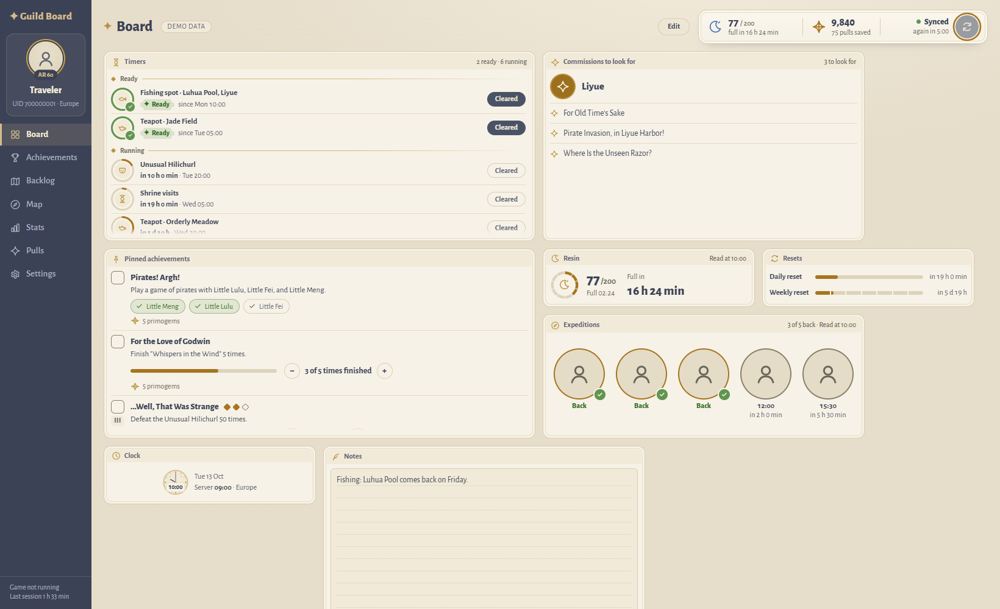
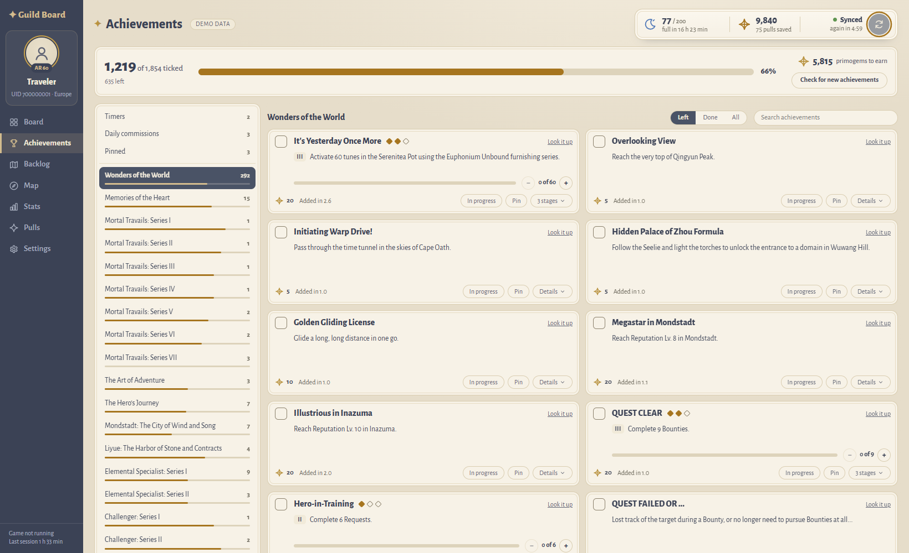
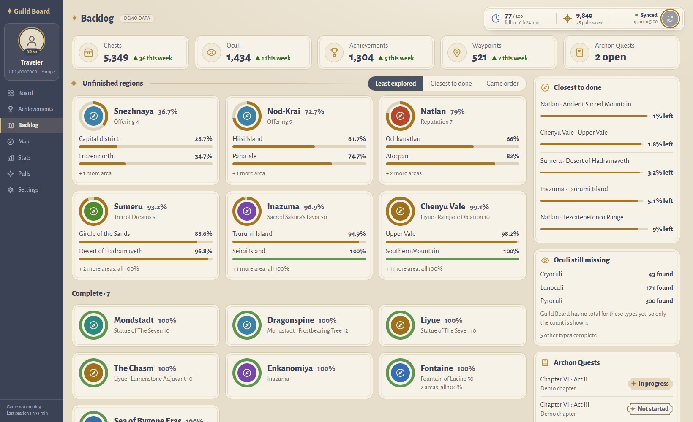
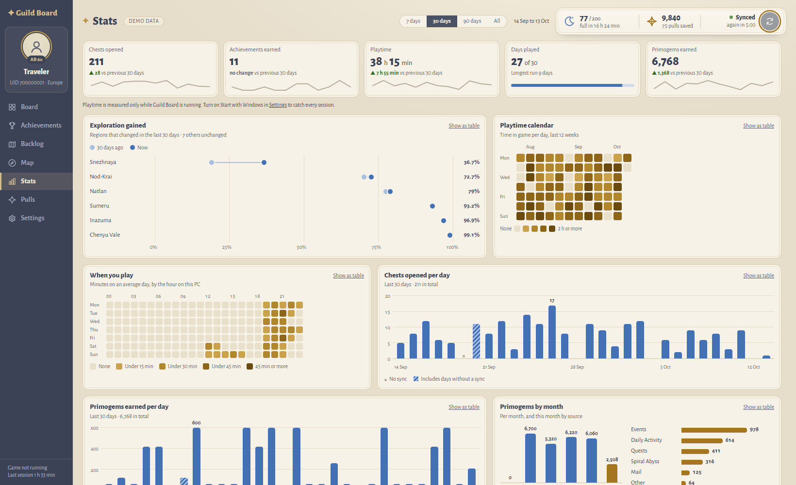
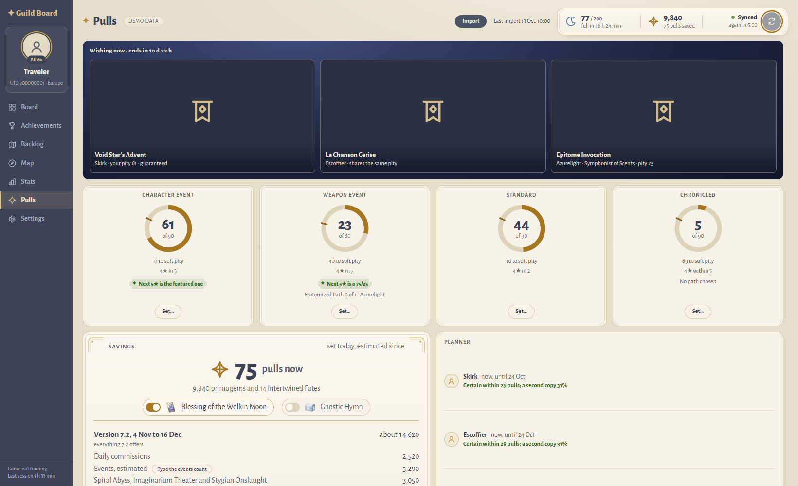
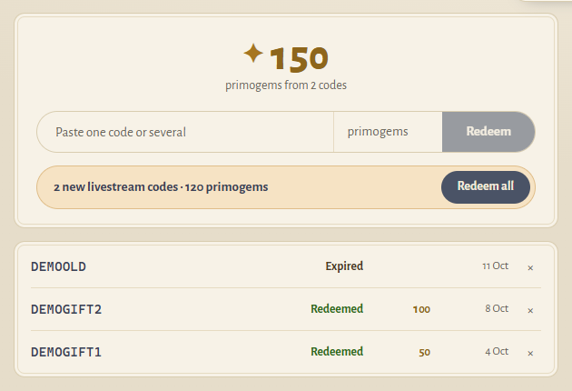
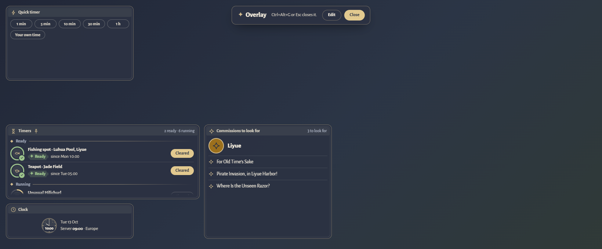

# ✦ Guild Board

**A calm, personal companion for Genshin Impact.**
It sits beside the game on your desktop, keeps track of everything you would otherwise keep in your head, and never touches the game itself.

### [⬇ Download the installer](https://github.com/QL1STY/guild-board-releases/releases/latest)

About 150 MB · no administrator rights needed · updates itself · your data stays on your PC

 

The Board, on demo data. Every card is a widget you can move, resize, add or remove.

 

## What it does

Guild Board reads your HoYoLAB account the way the official apps do, and turns it into a set of pages that answer the questions you keep asking yourself between sessions: *What is ready? What did I miss? What is left? Can I afford the next banner?*

### 🧭 The Board — your day at a glance

A dashboard made of widgets: **timers**, **today's commissions**, **resin** and its full time, **daily and weekly resets**, **expeditions**, **pinned achievements**, **notes**, a **clock** on server time, a **quick timer**, and six Pulls widgets. Press **Edit** to drag, resize and add. It remembers your layout.

### ⏳ Timers and reminders

Teapot coins, fishing spots, the Unusual Hilichurl, shrine visits and more come as ready-made timers, with the fishing spots of every region up to Nod-Krai and Snezhnaya. Make your own, or start a **quick timer** from one second to twelve hours.

When something is ready you get a **Windows notification**, and while the game runs, a short **line over the game**. Timers that finish together share one reminder, and nothing is reminded about twice, even if Guild Board was closed or the PC slept in between.

### 🏆 Achievements

The full achievement list with progress counters, stages, **pins** for the ones you are working on, and a "look it up" link on every card. Tick things off by hand, or check for new achievements from Paimon.moe's public list when you ask. Primogems still to earn are counted for you.

### 🗺 Backlog — what is left to explore

Every region and area with its exploration, offerings and reputation. See the regions that are **closest to done**, the **oculi still missing**, chests, waypoints and open Archon Quests, sorted the way you prefer.

### 📊 Stats

Chests opened, achievements earned, playtime, days played and primogems earned, each against the 30 days before. A **playtime calendar**, **when you play** by the hour, chests per day, primogems per day and per month by source. Every chart can be shown as a table.

### ✦ Pulls — pity, savings and a plan

Import your wish history and see the **pity** of every banner, what the current banners offer, and how your **luck** compares. Keep a **savings ledger** of the pulls you hold and the ones the next version will give you, and put the characters you want in a **planner** that tells you how likely you are to get them.

### 🌍 The interactive map

HoYoLAB's official Teyvat map, inside Guild Board, in **tabs** you can name and keep — one for fishing, one for a farming route. It signs in with your account and remembers which server you play on. Tabs you are not looking at fall asleep to save memory.

### 🎁 Gift codes

Paste a code, or several, and redeem them without leaving the window. Guild Board tells you when a **new livestream code** appears, keeps a history of the codes you used, and counts the primogems they gave. A code is redeemed only when *you* press the button.

### 🖥 The overlay

Press **Ctrl+Alt+G** and a panel of your widgets appears over the game: timers, commissions, a quick timer, whatever you pinned. Press it again and it is gone. It is a window of Guild Board's own, laid over the screen — not a hook into the game.

The overlay over a stand-in for the game.

### 🔧 And the rest

- **Backups** — export everything to a file and restore it on any PC. A copy is also made every day.
- **Start with Windows**, tray icon, and a profile panel with links to Akasha, Enka.Network and your Battle Chronicle.
- **Updates itself** — a new version shows at the bottom of the page and installs with one button. Your data stays.
- **A "what's new" card** after every update, in plain words.

 

## Hands off the game

Guild Board is built around a short list of promises. They are written into its tests, and the tests fail if the code ever breaks one.

| It never | |
|---|---|
| **touches the game's files or settings** | The only two things it reads there are the game's log and the wish-history links in its web cache — read-only, and only when you press **Import** on the Pulls page. |
| **touches the game's process** | No handle, no memory, no hooks, no injection. All it learns is *whether the game is running*, from the Windows process list. |
| **sends input to the game, or captures its screen** | The overlay is a separate window, not a layer inside the game. |
| **talks to anyone but HoYoverse** | `hoyolab.com`, `hoyoverse.com` and `mihoyo.com`, plus Paimon.moe's public achievement list when you ask, and this repository to look for updates. |
| **writes to your account** | It reads. The single exception is redeeming a gift code that *you* typed, pasted or clicked. |

Your HoYoLAB login is stored **only on your PC**, encrypted for your Windows user (DPAPI). It is never written to a log, never put in a backup, and never sent anywhere but to HoYoverse.

 

## Getting started

1. **[Download the installer](https://github.com/QL1STY/guild-board-releases/releases/latest)** (`Guild Board Setup <version>.exe`) and run it. No administrator rights are needed.
2. **Read the first-run page.** It lists exactly what is read and what is never done, and asks you to acknowledge the risk below.
3. **Log in to HoYoLAB** in Guild Board's own window — or choose **demo data** to look around first.
4. Wait for the first sync, and the Board fills in.

> Guild Board is not code-signed yet, so Windows SmartScreen may ask you to confirm on first run: choose **More info → Run anyway**.

**Updating** is automatic: Guild Board looks here twice a day and offers the new version with one button. An update or an uninstall leaves your data alone.

 

## An honest word about risk

Guild Board reads your account through HoYoLAB with your own login. That is low-risk, but **not zero-risk**: any third-party access is technically against HoYoverse's Terms of Service, and if action were ever taken, it would plausibly be against the HoYoLAB account rather than the game account. The developer of the most widely used tool of this kind says that no user has ever reported a ban. Guild Board only ever reads, keeps your login encrypted, and shows you all of this before it does anything.

 

## What is next

- **Characters** — pages for every character you own, planned by Guild Board itself from your account, your wishes and the game's data: what each one needs next, and what to do on which day. Designed, being built.
- **Open source.** See below.

### 🌱 Opening the source

Guild Board is going open source. It is not today: first the code needs tidying, and I would rather open it properly than quickly. The plan, in order:

1. **A clean-up pass** — remove anything personal from the code and its history, and write down how it is built and run.
2. **An audit of the promises above**, so anyone can check them against the code, which is the point of opening it.
3. **A license** — to be chosen; it will be an established open-source one.
4. **A public repository** for the code, with a contributing guide and issue templates. Installers keep being published here.

I will announce each step in this repository's releases.

 

## Questions

<b>Is it a cheat or a bot?</b>

No. It does not read or change the game's memory, does not send input, does not capture the screen and does not change a single file in the game's folder. It reads your public HoYoLAB data and, when you ask, the game's own wish-history links.

<b>Which servers does it work with?</b>

It is built for the global servers and HoYoLAB. Other regions are untested.

<b>Can it log in to the game, or change my password?</b>

No. The saved HoYoLAB login cannot log in to the game, change your password or show your email address.

<b>Where is my data?</b>

In a folder of your own on your PC (`%LOCALAPPDATA%\GuildBoard`). Nothing is uploaded. Use **Settings → Backups** to move it to another PC.

<b>Something is wrong, or I have an idea.</b>

Open an [issue](https://github.com/QL1STY/guild-board-releases/issues) here. Mention your version from **Settings → About**, and what you expected to happen.

 

Guild Board is an unofficial, fan-made tool. It is not affiliated with, endorsed by or connected to HoYoverse or COGNOSPHERE. Genshin Impact, HoYoLAB and Teyvat are trademarks of their owners. Screenshots show demo data, not a real account.

